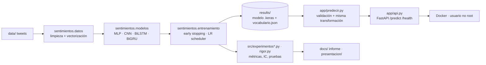

# Sentimiento en tweets en español con redes neuronales (CNN 1D vs. RNN)

**Curso:** Redes Neuronales · Ingeniería en Analítica de Datos · Taller ABP – Entrega 1
**Autor(es):** _[Nombre(s) y apellido(s)]_ · **Docente:** _[Nombre del docente]_

[](https://github.com/<usuario>/<repositorio>/actions)
[](https://creativecommons.org/licenses/by/4.0/)
 

> **Resumen.** Un sistema de punta a punta —datos → entrenamiento → evaluación rigurosa → API/Docker— que clasifica tweets en español como *negativo, neutro o positivo*. Más que perseguir una cifra récord, el proyecto estudia **qué arquitectura conviene cuando hay pocos datos** (1.839 tweets), con 5 semillas, intervalos de confianza y pruebas estadísticas. Resultado: una CNN 1D alcanza **53,8 % de exactitud (IC 95 %: 50,6–57,2 %)**, frente a 33,3 % del azar.

📄 Informe técnico completo (plantilla del curso): [`docs/Informe_Tecnico_Proyecto_Redes_Neuronales.docx`](docs/Informe_Tecnico_Proyecto_Redes_Neuronales.docx) · 🎞️ Presentación: [`presentacion/`](presentacion/) · 📓 Notebook: [`notebooks/proyecto_sentimientos.ipynb`](notebooks/proyecto_sentimientos.ipynb)

---

## 1. Problema y justificación

**Problema real.** Las organizaciones reciben miles de opiniones en redes sociales; leerlas manualmente no escala y las reglas por palabras clave fallan con el lenguaje coloquial (“qué mal… *jajaja*”, ironía, modismos). Se necesita un clasificador que priorice quejas y mida reputación.

**Tarea.** Clasificación multiclase de texto corto (3 clases), datos no estructurados y secuenciales.

**Pregunta de investigación.** ¿Una red convolucional 1D supera a las recurrentes (BiLSTM/BiGRU) y a una línea base clásica cuando el conjunto de entrenamiento es pequeño (~1.800 tweets)?

**Alternativas consideradas y por qué una red neuronal.**

| Alternativa | Ventaja | Limitación en este problema |
|---|---|---|
| Reglas / léxicos | Interpretables, sin entrenamiento | No capturan contexto, negación ni ironía |
| TF-IDF + regresión logística | Rápida, fuerte con pocos datos | Bolsa de n-gramas: sin representación distribuida ni orden |
| **Redes neuronales (embeddings + CNN/RNN)** | Aprenden representaciones y patrones locales/secuenciales; escalan con más datos | Riesgo de sobreajuste con pocos datos (se mide y controla aquí) |

**Justificación de herramientas.**

| Decisión | Alternativa | Razón |
|---|---|---|
| **Keras 3 / TensorFlow (CPU)** | PyTorch | Es el marco del curso (Elemento 3); API declarativa, serialización `.keras`, `TextVectorization` integrada |
| **CNN 1D multi-kernel** | LSTM/GRU, Transformers | Pocos parámetros efectivos, entrena en segundos, captura n-gramas; Transformers exigen preentrenamiento y GPU |
| **FastAPI + Docker** | Flask, notebook | Validación con *pydantic*, documentación automática, imagen reproducible sin privilegios |
| **GitHub Actions** | Pruebas manuales | Integración continua: cada *push* ejecuta las pruebas |
| **UMSAB/InterTASS** | Dataset propio | Referencia pública con particiones oficiales → comparabilidad |

**Viabilidad.** Entrena en ~5 s en CPU, el modelo pesa 3 MB y la inferencia es de milisegundos: se puede desplegar en cualquier máquina modesta.
**Aporte (honesto).** No es estado del arte; el valor está en un **estudio controlado y estadísticamente riguroso** del régimen de pocos datos y en un pipeline **reproducible hasta el despliegue**.

## 2. Datos

| | |
|---|---|
| Fuente | Subconjunto en español de **UMSAB** (InterTASS 2017, SEPLN-TASS) vía [cardiffnlp/xlm-t](https://github.com/cardiffnlp/xlm-t) (Barbieri et al., 2022) |
| Tamaño | 1.839 entrenamiento · 324 validación · 870 prueba (particiones oficiales) |
| Clases | 0 = negativo, 1 = neutro, 2 = positivo (entrenamiento balanceado: 613 por clase) |
| Longitud | media 15,9 palabras; percentil 95 = 26 → secuencias de 40 tokens |

Los datos están en `data/` (reproducible sin conexión) y conservan los términos de su fuente. **Preprocesamiento:** minúsculas, URLs y menciones → tokens genéricos, hashtags sin `#`, signos `!?¡¿` y emojis conservados, alargamientos reducidos; `TextVectorization` ajustada **solo con entrenamiento** (sin fuga de datos).

## 3. Arquitectura de la solución



**Modelo final** (268.515 parámetros) — CNN 1D multi-kernel:


`Embedding(8000×32) → SpatialDropout1D → 3×Conv1D(32; kernels 2,3,4)+GlobalMaxPool → Concat(96) → Dropout 0,3 → Dense(32, ReLU) → Dropout 0,3 → Softmax(3)` · Adam (lr 1e-3), entropía cruzada, batch 32, L2 1e-4, *early stopping* y `ReduceLROnPlateau`.

**Buenas prácticas aplicadas**
- **Modularidad:** paquete `src/sentimientos/` (datos · modelos · entrenamiento) separado de la app, los experimentos y las pruebas; semillas fijas; hiperparámetros explícitos.
- **Sin fuga de datos:** vocabulario ajustado solo con *train*; el test se usa una vez al final; selección de hiperparámetros en validación con 3 semillas por configuración.
- **Pruebas automatizadas:** 11 pruebas (`pytest`) de inferencia, entradas inválidas, consistencia del vectorizador, no degradación del modelo y API.
- **Seguridad:** validación estricta de entradas, vocabulario en JSON (sin *pickle*), contenedor sin privilegios, sin registrar textos de usuarios — ver [`SECURITY.md`](SECURITY.md).
- **Escalabilidad:** la API es *stateless* (varias réplicas tras un balanceador); admite lotes de hasta 64 textos; el modelo es intercambiable (misma interfaz `predecir`).

## 4. Resultados (conjunto de prueba, 870 tweets)

| Modelo | Exactitud | F1 macro | IC 95 % exactitud |
|---|---|---|---|
| TF-IDF + Regresión logística | 0,505 | 0,503 | 47,1 – 53,7 % |
| BiGRU (ensamble de 5) | 0,501 | 0,481 | 46,7 – 53,6 % |
| MLP (ensamble de 5) | 0,530 | 0,526 | 49,9 – 56,2 % |
| **CNN 1D final (ensamble de 5)** | **0,538** | **0,537** | **50,6 – 57,2 %** |
| CNN 1D final (5 semillas, individual) | 0,516 ± 0,012 | 0,514 ± 0,011 | — |

Por clase (ensamble CNN, F1): negativo 0,57 · neutro 0,47 · positivo 0,57. Matriz de confusión: `results/matriz_confusion.png`.

**Rigor estadístico** (`src/rigor.py` → `results/rigor_estadistico.json`):
- CNN vs. azar (33,3 %): p < 10⁻³⁴ (prueba binomial).
- CNN vs. BiGRU: McNemar p = 0,032 (significativa).
- CNN vs. TF-IDF: McNemar p = 0,055; diferencia de exactitud +3,4 puntos (IC 95 %: +0,1 a +6,7). **Evidencia sugerente, no concluyente.**
- CNN vs. MLP: p = 0,63 (indistinguibles).
- **Curva de aprendizaje** (`results/curva_aprendizaje.png`): F1 sube de 0,43 (25 % de los datos) a 0,50 (100 %) sin saturarse → el rendimiento está **limitado por los datos**.

**Experimentos controlados** (`src/experimentos_controlados.py`, un cambio a la vez, 3 semillas; F1 macro en prueba): referencia 0,523 · filtros 16 → 0,506 · filtros 128 → 0,491 · tanh → 0,507 · sigmoid → 0,472 · lr 1e-4 → 0,509 · lr 1e-2 → 0,459 · SGD sin momentum → 0,365 · SGD+momentum → 0,489 · AdamW → 0,513 · sin regularización → 0,508 · dropout 0,6 → 0,501 · batch 8 → 0,505 · batch 128 → 0,516. Las diferencias entre configuraciones razonables (≈ ±0,02) están dentro del ruido entre semillas.

## 5. Discusión y limitaciones
- **CNN > RNN en pocos datos:** BiLSTM/BiGRU son más inestables (±2–3 puntos) y significativamente peores que la CNN; coherente con la compartición de pesos y menor varianza de las convoluciones.
- **Sobreajuste dominante:** la CNN llega a ~96 % de exactitud en entrenamiento frente a ~53 % en prueba. Dropout/L2 lo retrasan; el *early stopping* es la defensa efectiva (`results/ablacion_regularizacion.png`).
- **Errores:** la clase neutra es la más difícil; los errores más confiados ocurren con ironía y emociones mezcladas (“qué triste… ya consigo otro”). La importancia por oclusión muestra que la red usa palabras emocionales plausibles (*triste, malo, peor* → negativo; *genial, gracias, bonito* → positivo), sin implicar causalidad.
- **Límites:** conjunto pequeño; sin embeddings preentrenados (el entorno de desarrollo no tenía acceso a ellos); un solo dominio (tweets de 2017); no hay evaluación de sesgos por variedad dialectal.
- **Ética:** el texto puede contener datos personales; la API no los almacena. No debe usarse para decisiones automáticas sobre personas sin supervisión humana.

## 6. Instalación y despliegue

```bash
git clone https://github.com/<usuario>/<repositorio>.git && cd <repositorio>
python -m venv .venv && source .venv/bin/activate        # Windows: .venv\Scripts\activate
pip install -r requirements.txt
pytest -q tests                                          # 11 pruebas
```
**Uso por línea de comandos**
```bash
python app/predecir.py "Qué día tan bonito, gracias!"
```
**API REST**
```bash
uvicorn app.api:app --port 8000          # documentación interactiva en http://localhost:8000/docs
curl -X POST localhost:8000/predict -H 'content-type: application/json' -d '{"textos":["Qué asco de servicio"]}'
```
**Docker** (sin privilegios; _no se construyó en el entorno de desarrollo, se recomienda verificarlo_)
```bash
docker build -t sentimientos-es . && docker run -p 8000:8000 sentimientos-es
```
**Reproducir los experimentos** (CPU, semillas fijas; ~25 min el principal)
```bash
python src/experimentos.py            # arquitecturas, ablación, búsqueda de hiperparámetros
python src/experimentos_controlados.py
python src/analisis.py                # errores, oclusión, verificación manual del forward pass
python src/rigor.py                   # IC bootstrap, McNemar, curva de aprendizaje
jupyter notebook notebooks/proyecto_sentimientos.ipynb
```

## 7. Estructura del repositorio
```
├── README.md · LICENSE · SECURITY.md · CITATION.cff
├── requirements.txt · Dockerfile · .github/workflows/ci.yml
├── data/                     # train/val/test
├── src/
│   ├── sentimientos/         # datos.py · modelos.py · entrenamiento.py
│   ├── experimentos.py · experimentos_controlados.py · analisis.py · rigor.py
├── app/                      # predecir.py (CLI) · api.py (FastAPI)
├── tests/                    # pytest
├── notebooks/                # recorrido completo ejecutado
├── results/                  # métricas JSON, figuras, modelo .keras, vocabulario
├── docs/                     # informe técnico (.docx) y diagrama
└── presentacion/             # PPTX y PDF
```

## 8. Potencial de investigación (semillero)
Líneas que este trabajo habilita, con base en sus propios hallazgos:
1. **Aprendizaje con pocos datos en español:** embeddings preentrenados (fastText/BETO), *fine-tuning* de XLM-R y aumento de datos, midiendo con la misma curva de aprendizaje y pruebas estadísticas.
2. **Ironía y clase neutra:** análisis de errores sistemáticos y *datasets* de ironía en español.
3. **Robustez entre dominios y variedades dialectales** (España, México, Colombia…) y auditoría de sesgos.
4. **Metodología:** el protocolo (multi-semilla, IC bootstrap, McNemar, curva de aprendizaje) es transferible a otros problemas de PLN con pocos datos.

## 9. Referencias
- Barbieri, F., Espinosa Anke, L., & Camacho-Collados, J. (2022). *XLM-T: Multilingual Language Models in Twitter for Sentiment Analysis and Beyond.* LREC.
- Díaz Galiano, M. C. et al. (2018). *Overview of TASS 2017.* Procesamiento del Lenguaje Natural.
- Kim, Y. (2014). *Convolutional Neural Networks for Sentence Classification.* EMNLP.
- Goodfellow, I., Bengio, Y., & Courville, A. (2016). *Deep Learning.* MIT Press · Berzal, F. (2018). *Redes neuronales & deep learning.*

## 10. Licencia
Código, documentación técnica, README y presentación: **[Creative Commons Atribución 4.0 Internacional (CC BY 4.0)](https://creativecommons.org/licenses/by/4.0/deed.es)**. Los datos conservan los términos de sus fuentes originales.

© _[Año] [Nombre(s) del/los autor(es)]_ — [](https://creativecommons.org/licenses/by/4.0/)
